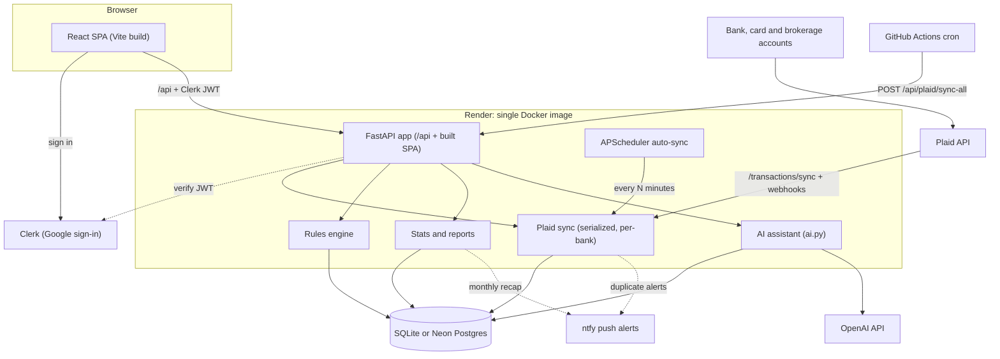

<div align="center">

# 💸 Expense Tracker

**A personal, full-stack finance tracker: real bank accounts synced through Plaid, with an AI assistant built in.**

[](https://github.com/apatwal/ledger/actions/workflows/ci.yml)
[](https://github.com/apatwal/ledger/actions/workflows/e2e.yml)
<br />


<br />


[Features](#-features) · [Quick start](#-quick-start) · [Configuration](#-configuration) · [Deploy](#-deployment) · [API](#-api)

</div>

---

A personal, full-stack expense and finance tracker built to replace a manual,
per-month spreadsheet workflow. It connects real bank and credit-card accounts
through **Plaid**, so transactions flow in automatically. One persistent
transaction table backs every view, so any time window (month, quarter, year,
or custom range) is just a query, and year-end stats come for free.

## ✨ Features

| Feature | What it does |
| --- | --- |
| **Plaid bank sync** (primary) | Connect real bank, credit-card, and brokerage accounts; transactions sync in automatically, enriched and categorized. |
| **Accounts** | A wallet page for connecting banks and cards, with per-bank health, **Reconnect**, **+ Add accounts**, and account nicknames. |
| **Dashboard** | KPI cards, spend-over-time, category, and income-vs-expense charts, scoped by date range and accounts. |
| **Transactions** | Filterable, paginated ledger with add / edit / delete. |
| **Investments** | Holdings and portfolio value over time for brokerage accounts. |
| **Budgets** | Monthly per-category limits and savings goals, tracked against live spend. |
| **AI assistant** (OpenAI) | Auto-categorization, spending Q&A, insights, and natural-language budget/goal creation. |
| **Rules + review queue** | Keyword/amount rules that set type, category, or account; ambiguous rows are flagged for review. |
| **Duplicate detection** | Groups likely double-charges for review, with optional push alerts via ntfy. |
| **Statistics API** | Summary, by-category, over-time, by-account, net-worth, and investment-flow endpoints. |
| **Authentication** (Clerk) | Optional Google sign-in with an email allowlist; hard-required in production. |
| **Readable errors** | Plain-English error messages with a **Details** toggle and an error ID. |

<details>
<summary><b>Plaid bank sync: how it works</b></summary>

<br />

Connect real bank, credit-card, and brokerage accounts via Plaid Link.

- **Incremental sync.** Transactions sync through `/transactions/sync` with a
  persisted cursor, are categorized from Plaid's `personal_finance_category`, and
  are enriched with merchant logos, institution branding, account balances, and
  pending-vs-posted status.
- **24 months of history.** New links request up to **24 months** of history.
- **Investments are optional.** They're supported when the institution offers
  them, but never block a card/bank-only link.
- **Ways to trigger a sync.** Manual sync from the app, an optional in-process
  auto-sync (APScheduler), a `/sync-all` cron endpoint, and Plaid webhooks.
- **Isolated per bank.** One unhealthy institution can't fail the run or stop the
  others. It's flagged in the wallet with the reason, and **Reconnect** reopens
  Plaid Link in update mode to repair it (re-auth + account re-selection).
- **Serialized and exactly-once.** The cron, scheduler, webhooks, and manual
  syncs can't overlap, and a unique index guarantees one row per Plaid
  transaction, so a bank charge can never be imported (or counted) twice.
- **$0 brokerage events are skipped.** In-kind share transfers and stock splits
  aren't money movement and are never imported.
- **One connection per bank.** To add an account at a bank you've already linked,
  use **+ Add accounts** on its card, which reopens Plaid's account picker against
  the same connection. Linking the bank a second time is refused, since that would
  duplicate the accounts you already have (and double-count them in net worth).
- **Portfolio snapshots.** Each sync also records a portfolio-value snapshot,
  which feeds the Investments page.

</details>

<details>
<summary><b>Dashboard, transactions, and budgets</b></summary>

<br />

- **Dashboard.** KPI cards (income, expense, net, savings rate), a spend-over-time
  area chart, a category donut, and an income-vs-expense bar chart, driven by a
  date-range and granularity selector, plus a per-account spending breakdown. A
  global multi-account selector scopes every view.
- **Transactions.** A filterable, paginated ledger with add / edit / delete via a
  modal form. Filter by date range, type, category, account, or "needs review".
- **Budgets.** Monthly per-category spending limits and savings goals, tracked
  against live spend. They can be created conversationally through the AI
  assistant.

</details>

<details>
<summary><b>AI assistant, rules, and statistics</b></summary>

<br />

- **AI assistant (OpenAI).** On-demand auto-categorization, spending Q&A,
  spending insights, and natural-language budget/goal creation. Optional;
  requires an `OPENAI_API_KEY` (model defaults to `gpt-4o-mini`).
- **Rules engine + needs-review queue.** User-editable keyword/amount rules that
  set type, category, or account; ambiguous rows are flagged for review instead
  of being silently miscounted.
- **Statistics API.** Summary, by-category, over-time (year/month/week/day),
  by-account, net-worth, and investment-flow endpoints. Transfers (including
  credit-card payments) are excluded from spending stats so a payment never
  double-counts its purchases; refunds net against category spend.

</details>

<details>
<summary><b>Notifications: duplicate alerts and monthly recap</b></summary>

<br />

- **Duplicate charges.** Two or more expenses with matching date, amount,
  description, and account are grouped for review, which catches both real merchant
  double-charges and overlapping imports. Dismissed groups stay dismissed.
- **Real-time alerts.** When a sync finds a new duplicate, a push notification is
  sent to your [ntfy](https://ntfy.sh) topic (set `NTFY_TOPIC`; off when unset).
- **Monthly recap.** `POST /api/reports/monthly` pushes a spend recap of the
  previous month via ntfy. A scheduled GitHub Actions workflow calls it on the 1st
  of each month.

</details>

<details>
<summary><b>Authentication and readable errors</b></summary>

<br />

- **Authentication (Clerk).** Optional Google sign-in via Clerk with server-side
  JWT verification and an email allowlist. Off by default locally; hard-required
  in production (see [Configuration](#-configuration)).
- **Readable errors.** When something fails, the page says what in plain English
  ("Couldn't load transactions") and keeps the technical record behind a
  **Details** toggle: the request, status, the real cause (e.g.
  `ResponseValidationError: row 0 (id 1662) amount: …`) and an **error ID**, with a
  Copy button. Search Render's logs for the error ID to find the full stack trace,
  which is never sent to the browser. Nothing is stored; it's on screen only. See
  *Errors* in [`docs/api-contract.md`](docs/api-contract.md).

</details>

<details>
<summary><b>CSV import (decommissioned)</b></summary>

<br />

A bank-agnostic drag-and-drop importer that predates the Plaid integration. Now
that the app is Plaid-first, its UI is **hidden behind the `CSV_IMPORT_ENABLED`
flag** (off by default; see [`src/lib/features.ts`](src/lib/features.ts)). The
code (frontend component, API client, and `csv_import`/`imports` backend routes)
is kept intact; flip the flag and rebuild to restore the Import page for a
one-off backfill.

</details>

## 🧭 Architecture



In production, FastAPI serves both `/api` and the built SPA from one origin, so
there's no CORS. Locally, the Vite dev server on port 3000 proxies `/api` to the
backend on port 8000.

## 🧱 Tech stack

| Layer | Tools |
| --- | --- |
| **Backend** | FastAPI, SQLAlchemy 2.x, Pydantic 2.x. SQLite by default (zero-config); Postgres-ready via `DATABASE_URL` (e.g. Neon). Plaid (`plaid-python`) for bank sync, the OpenAI Python SDK (`openai`) for AI, PyJWT for Clerk session verification, APScheduler for auto-sync. |
| **Frontend** | React 18, Vite 5, TypeScript, React Router, TanStack Query, Recharts, lucide-react, `@clerk/react`, `react-plaid-link`. |
| **Deploy** | Single Docker image: FastAPI serves both `/api` and the built SPA from one origin. Render Blueprint (`render.yaml`) + Neon Postgres. |
| **Tests** | pytest + httpx (isolated in-memory SQLite); Playwright e2e. GitHub Actions CI. |

## 📁 Project layout

```
src/api/            FastAPI backend (main.py, database.py, models.py, schemas.py,
                    rules_engine.py, ai.py, plaid_client.py, plaid_mapping.py,
                    auth.py, errors.py, notify.py, routes/)
src/components/     React views (Dashboard, Transactions, Accounts, Holdings,
                    Budget, Rules, Assistant, PlaidConnect, AuthGate, Layout, ...)
src/lib/            API client, shared TypeScript types, feature flags
src/styles/         Global theme
tests/              pytest suite + fixtures
e2e/                Playwright end-to-end suite
docs/               api-contract.md, DEPLOY.md, build-summary.md, backend notes
.github/workflows/  CI, e2e, scheduled Plaid sync, monthly report
requirements.txt    backend (Python) dependencies
package.json        frontend (Node) dependencies
```

## 🚀 Quick start

1. **Install the prerequisites:** **Python 3.10+** and **Node.js 18+** (with npm).

2. **Configure your environment.** Clone the repo and, from the project root,
   copy the example env file:

   ```bash
   cp .env.example .env
   # then fill in the keys you want (all are optional for a bare local run;
   # see Configuration below)
   ```

   `.env` and the SQLite database file are gitignored.

3. **(Optional) Turn on the AI assistant** (auto-categorize, Q&A, insights,
   budget creation). Set `OPENAI_API_KEY` in `.env` to a key from
   <https://platform.openai.com/api-keys>, and optionally `OPENAI_MODEL`
   (defaults to `gpt-4o-mini`). Without a key the app runs normally and the
   assistant stays hidden.

4. **Start the backend** (port 8000):

   ```bash
   python3 -m venv .venv
   source .venv/bin/activate
   pip install -r requirements.txt
   uvicorn src.api.main:app --reload --port 8000
   ```

   Interactive API docs are available at http://localhost:8000/docs.

5. **Start the frontend** (port 3000). In a second terminal, from the project root:

   ```bash
   npm install      # first time only
   npm run dev
   ```

   Then open **http://localhost:3000**. The Vite dev server proxies `/api` to the
   backend on port 8000, so both run on a single origin during development.

6. **(Optional) Build the frontend for production:**

   ```bash
   npm run build    # type-checks with tsc, then builds to dist/
   npm run preview  # serve the production build locally
   ```

## 🔧 Configuration

Environment variables (see [`.env.example`](.env.example) for the full list and
notes). Everything is optional for a bare local run; features light up as you
add keys.

### AI

| Variable | Purpose | Default / notes |
| --- | --- | --- |
| `OPENAI_API_KEY` | Enables the AI assistant, auto-categorize, and insights. | Create one at <https://platform.openai.com/api-keys>. Unset: AI endpoints return `503`. |
| `OPENAI_MODEL` | Model override. | `gpt-4o-mini` |
| `APP_TIMEZONE` | The IANA zone the AI treats as "today". | `America/New_York`. The server itself runs in UTC. |

OpenAI failures (bad key, rate limit or exhausted quota, timeout) come back as a
readable `502`/`503` that the Assistant shows in its error notice.

### Database

| Variable | Purpose | Default / notes |
| --- | --- | --- |
| `DATABASE_URL` | Database connection string. | Unset uses local SQLite; set a `postgresql://…` URL for Postgres/Neon. |
| `DB_KEEPALIVE_SECONDS` | Pings `SELECT 1` every N seconds to keep Neon from scaling to zero while the server runs. | Off. Postgres only; doesn't help while the host itself is asleep (Render free tier). |
| `DB_POOL_SIZE` / `DB_MAX_OVERFLOW` / `DB_POOL_RECYCLE` | Connection-pool overrides. | `5` / `5` / `300` seconds. Postgres only. |

### Plaid

| Variable | Purpose | Default / notes |
| --- | --- | --- |
| `PLAID_CLIENT_ID`, `PLAID_SECRET` | Plaid API keys. | Unset: `/api/plaid/*` returns `503` and the rest of the app works. |
| `PLAID_ENV` | Plaid environment: `sandbox`, `development`, or `production`. | `sandbox` |
| `PLAID_PRODUCTS` | Comma-separated Plaid products. | `transactions,investments` |
| `PLAID_COUNTRY_CODES` | Comma-separated country codes. | `US` |
| `PLAID_REDIRECT_URI` | OAuth redirect URI registered in the Plaid dashboard. | Required for OAuth banks. |
| `PLAID_SYNC_TOKEN` | Shared secret (header `X-Plaid-Sync-Token`) for `POST /api/plaid/sync-all` and `POST /api/reports/monthly`. | Used by the scheduled GitHub Actions workflows. |
| `PLAID_AUTOSYNC_INTERVAL_MINUTES` | Runs an in-process scheduler that syncs every N minutes. | Off. For always-on instances. |
| `PLAID_WEBHOOK_URL` | Public https URL of `POST /api/plaid/webhook`. | Unset: no webhooks (manual/cron sync still works). Pushed to already-linked items on boot. |

> [!NOTE]
> `PLAID_ENV` defaults to `sandbox`. A production secret needs
> `PLAID_ENV=production`, or Plaid calls fail against the wrong host.

### Auth (Clerk)

| Variable | Purpose | Default / notes |
| --- | --- | --- |
| `CLERK_ISSUER` | Your Clerk Frontend API URL. Setting it turns auth ON: all `/api` routes then require a valid Clerk session JWT. | Unset: auth is off. `/api/health` and the SPA always stay open. |
| `CLERK_JWKS_URL` | Overrides the JWKS endpoint (also turns auth on). | `${CLERK_ISSUER}/.well-known/jwks.json` |
| `ALLOWED_EMAILS` | Comma-separated email allowlist. | Empty: any authenticated Clerk user is allowed. |
| `CLERK_SECRET_KEY` | Enables server-side email lookup. | Optional. |
| `VITE_CLERK_PUBLISHABLE_KEY` | The frontend Clerk key, inlined at build time. | Set on the frontend build/host. |
| `REQUIRE_AUTH` | Production safety switch. | Auto-set on Render. |

> [!WARNING]
> With `REQUIRE_AUTH=true` (auto-set on Render) the app **refuses to boot** if
> auth is disabled, so a prod deploy is never wide-open.

<details>
<summary><b>Notifications (ntfy)</b></summary>

<br />

| Variable | Purpose | Default / notes |
| --- | --- | --- |
| `NTFY_TOPIC` | ntfy topic for duplicate-charge alerts and the monthly recap. | Unset: notifications are disabled. |
| `NTFY_SERVER` | Self-hosted ntfy server base URL. | `https://ntfy.sh` |
| `NTFY_TOKEN` | ntfy access token (`tk_...`). | Unset: anonymous publishing, which ntfy.sh rate-limits per source IP (a problem on shared-IP hosts like Render). |
| `APP_URL` | App base URL for the alert's click action (deep-links to `/dashboard`). | Optional. |

</details>

<details>
<summary><b>Server and development extras</b></summary>

<br />

| Variable | Purpose | Default / notes |
| --- | --- | --- |
| `CORS_ORIGINS` | Comma-separated allowed browser origins for cross-origin `/api` calls. | `http://localhost:3000`. Not needed in single-origin prod. |
| `SEED_DB` | Seeds sample transactions into an empty DB on startup (`1`, `true`, or `yes`). | Off. Not in `.env.example`. |
| `STATIC_DIR` | Where FastAPI looks for the built SPA. | `<project root>/dist`. Not in `.env.example`. |

</details>

## 🚢 Deployment

Ships as one Docker service (FastAPI serves the API and the built SPA from a
single origin, so there's no CORS in prod) deployed to Render with Neon Postgres.
See [`docs/DEPLOY.md`](docs/DEPLOY.md) for the full walkthrough.

Commits that only touch Markdown files or `docs/` don't trigger a Render rebuild
(`buildFilter.ignoredPaths` in [`render.yaml`](render.yaml)).

Scheduled jobs run as GitHub Actions workflows that call the live app with the
`X-Plaid-Sync-Token` header:

- [`plaid-sync.yml`](.github/workflows/plaid-sync.yml): `POST /api/plaid/sync-all` every 6 hours.
- [`monthly-report.yml`](.github/workflows/monthly-report.yml): `POST /api/reports/monthly` on the 1st of each month.

## 🧪 Running the tests

```bash
source .venv/bin/activate
pytest              # backend unit/integration (in-memory SQLite; OpenAI is mocked)
npm run e2e         # Playwright end-to-end
```

CI ([`ci.yml`](.github/workflows/ci.yml)) runs the type-check + build and
`pytest` on every push and pull request. The Playwright suite
([`e2e.yml`](.github/workflows/e2e.yml)) runs on pushes and PRs to `main`.

## 🔌 API

All routes are under `/api`. Health check: `GET /api/health`. The full contract
and data model are documented in [`docs/api-contract.md`](docs/api-contract.md),
and a narrative of what was built in [`docs/build-summary.md`](docs/build-summary.md).
